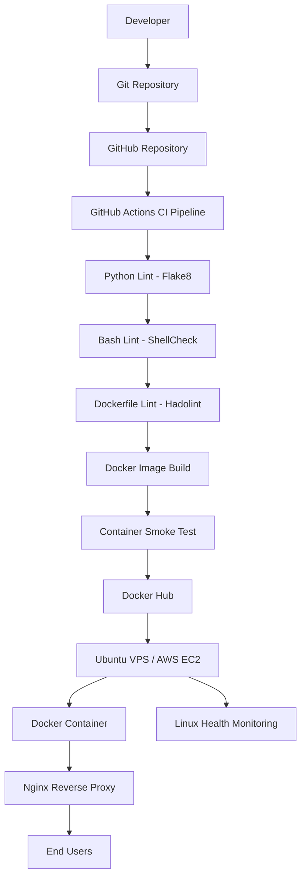

# DevOps Task – Flask Application with Docker & CI/CD

A practical DevOps project demonstrating Python application development, Docker containerization, CI/CD automation using GitHub Actions, Docker Hub image publishing, and Linux system health monitoring.

---

## 1. Project Overview

This project demonstrates a basic end-to-end DevOps workflow by building and containerizing a Flask web application and automating the build, testing, and deployment preparation process.

The project includes:

- Flask-based Python web application
- Docker multi-stage build
- Docker Compose for container management
- Non-root Docker container execution
- Git and GitHub version control
- GitHub Actions CI pipeline
- Python code quality checks using Flake8
- Shell script validation using ShellCheck
- Dockerfile validation using Hadolint
- Automated Docker image build and smoke testing
- Docker Hub image publishing
- Linux CPU, memory, and disk monitoring
- AWS EC2 deployment plan

**Project Goal:** Understand and implement a practical DevOps workflow from source code to container image delivery.

## 2. Architecture

The following diagram illustrates the project workflow.



## 3. Technology Stack

| Category | Technology |
|---|---|
| Programming Language | Python 3.12 |
| Web Framework | Flask |
| Production Server | Gunicorn |
| Containerization | Docker |
| Container Management | Docker Compose V2 |
| Version Control | Git |
| Source Code Hosting | GitHub |
| CI/CD | GitHub Actions |
| Python Linting | Flake8 |
| Shell Script Linting | ShellCheck |
| Dockerfile Linting | Hadolint |
| Container Registry | Docker Hub |
| Operating System | Ubuntu Linux |
| Cloud Platform | AWS EC2 |
| Web Server / Reverse Proxy | Nginx |
| SSL Certificate | Let's Encrypt |

## 4. Project Structure

```text
devops-task/
│
├── .github/
│   └── workflows/
│       └── ci.yml
│
├── app.py
├── requirements.txt
├── Dockerfile
├── docker-compose.yml
├── .dockerignore
├── .gitignore
├── system_health.sh
├── README.md
│
└── health_log.txt          # Generated at runtime
```

### File Descriptions

| File | Purpose |
|---|---|
| `app.py` | Flask application source code |
| `requirements.txt` | Python dependencies |
| `Dockerfile` | Docker image build instructions |
| `docker-compose.yml` | Container configuration |
| `.dockerignore` | Excludes unnecessary files from Docker build |
| `.gitignore` | Excludes local and temporary files from Git |
| `.github/workflows/ci.yml` | GitHub Actions CI pipeline |
| `system_health.sh` | Linux system monitoring script |
| `README.md` | Project documentation |
| `health_log.txt` | Stores monitoring output |

## 5. Prerequisites

Install the following software before running the project:

- Python 3.12 or compatible version
- Docker Desktop
- Docker Compose V2
- Git
- Visual Studio Code (recommended)
- GitHub account
- Docker Hub account

Verify the installations:

```bash
python --version
git --version
docker --version
docker compose version
```

Check Docker Engine:

```bash
docker info
```

## 6. Application Setup

### Step 1: Clone the Repository

Replace `YOUR_USERNAME` with your GitHub username.

```bash
git clone https://github.com/YOUR_USERNAME/devops-task.git

cd devops-task
```

### Step 2: Create a Python Virtual Environment

```bash
python -m venv venv
```

Activate on Windows PowerShell:

```powershell
.\venv\Scripts\Activate.ps1
```

Activate on Linux:

```bash
source venv/bin/activate
```

### Step 3: Install Dependencies

```bash
python -m pip install -r requirements.txt
```

### Step 4: Run the Application

```bash
python app.py
```

Open the application:

http://localhost:8080

Expected JSON response:

```json
{
  "message": "Hello from DevOps Task!",
  "status": "running"
}
```

Stop the application using `CTRL + C`.

## 7. Docker Implementation

The application is containerized using a multi-stage Docker build.

### Docker Features

- Multi-stage image build to separate dependency installation from runtime.
- Python slim base image to reduce image size.
- Gunicorn as the production WSGI server.
- Non-root user for improved container security.
- Docker HEALTHCHECK for container health monitoring.
- `.dockerignore` to reduce unnecessary build context.
- Docker Compose for simplified container management.

### Build and Run with Docker Compose

Build the image and start the container:

```bash
docker compose up --build -d
```

Check running containers:

```bash
docker ps
```

View application logs:

```bash
docker compose logs -f
```

Test the application:

```bash
curl http://localhost:8080
```

On Windows PowerShell, use:

```powershell
curl.exe http://localhost:8080
```

Verify the container user:

```bash
docker exec devops-task-app whoami
```

Expected output:

```text
appuser
```

Check container health:

```bash
docker inspect --format='{{.State.Health.Status}}' devops-task-app
```

Stop and remove the container:

```bash
docker compose down
```

## 8. CI Pipeline – GitHub Actions

The project uses GitHub Actions to automate code validation, Docker image building, container testing, and Docker Hub publishing.

The workflow is triggered automatically when code is pushed to the `main` branch.

### CI Pipeline Stages

**Stage 1 – Source Checkout**

GitHub Actions checks out the latest source code.

**Stage 2 – Python Code Validation**

Flake8 checks the Python application for common coding errors and style issues.

**Stage 3 – Bash Script Validation**

ShellCheck validates the Linux monitoring script.

**Stage 4 – Dockerfile Validation**

Hadolint checks Dockerfile best practices and potential issues.

**Stage 5 – Docker Image Build**

The pipeline builds the Docker image and tags it with:

- `latest`
- Git commit SHA

**Stage 6 – Container Smoke Test**

The pipeline starts the container and verifies that the application responds successfully.

**Stage 7 – Docker Hub Publishing**

After successful validation and testing, the pipeline logs in to Docker Hub and pushes both image tags.

### Required GitHub Secrets

Configure the following secrets in:

`GitHub Repository → Settings → Secrets and variables → Actions`

| Secret Name | Description |
|---|---|
| `DOCKERHUB_USERNAME` | Docker Hub username |
| `DOCKERHUB_TOKEN` | Docker Hub access token with Read & Write permission |

Never store Docker Hub credentials directly in the source code or commit them to GitHub.

### Workflow File

Location:

```text
.github/workflows/ci.yml
```

The CI workflow contains the automation instructions for linting, building, testing, and publishing the Docker image.

## 9. Docker Hub Image Publishing

The CI pipeline publishes the Docker image to Docker Hub after successful validation and smoke testing.

Pull the latest image:

```bash
docker pull YOUR_DOCKERHUB_USERNAME/devops-task-app:latest
```

Run the image:

```bash
docker run -d \
  --name final-test \
  -p 8080:8080 \
  YOUR_DOCKERHUB_USERNAME/devops-task-app:latest
```

Test the application:

```bash
curl http://localhost:8080
```

Verify the container:

```bash
docker ps
```

Remove the test container:

```bash
docker rm -f final-test
```

## 10. Linux System Health Monitoring

The project includes a Bash script to monitor basic Linux system resources.

Script:

```text
system_health.sh
```

### Monitoring Metrics

| Metric | Description |
|---|---|
| CPU Usage | Calculates CPU utilization |
| Memory Usage | Reports memory utilization |
| Disk Usage | Checks root filesystem usage |
| Disk Warning | Generates a warning when disk usage exceeds 80% |
| Log Management | Saves monitoring output in a log file |

### Run the Monitoring Script

On Ubuntu or another compatible Linux system:

```bash
bash system_health.sh
```

View monitoring logs:

```bash
cat health_log.txt
```

Example output:

```text
[2026-11-06 10:30:00] CPU: 12% | Memory: 45% | Disk: 38%
```

If disk usage exceeds the configured threshold, the script generates a warning.

### Run on Windows Using Docker

If Linux is not installed locally, run the script inside an Ubuntu container from PowerShell:

```powershell
docker run --rm -it -v "${PWD}:/work" -w /work ubuntu:24.04 bash -c "apt-get update -qq && apt-get install -y -qq procps && bash system_health.sh"
```

The generated `health_log.txt` will be available in the project directory.

## 11. AWS EC2 Deployment Plan

The application can be deployed to an Ubuntu EC2 instance using the Docker image published to Docker Hub.

### Deployment Steps

1. Launch an Ubuntu EC2 instance.
2. Configure the required Security Group rules.
3. Connect to the instance using SSH.
4. Install Docker Engine and Docker Compose.
5. Pull the application image from Docker Hub.
6. Run the Docker container.
7. Configure Nginx as a reverse proxy.
8. Configure a domain name if available.
9. Enable HTTPS using Let's Encrypt.
10. Verify application availability.
11. Configure system health monitoring.

### Example Docker Deployment Commands

After installing Docker on the EC2 instance:

```bash
docker pull YOUR_DOCKERHUB_USERNAME/devops-task-app:latest
```

Run the application:

```bash
docker run -d \
  --name devops-task-app \
  --restart unless-stopped \
  -p 127.0.0.1:8080:8080 \
  YOUR_DOCKERHUB_USERNAME/devops-task-app:latest
```

The application listens locally on port `8080`; Nginx can proxy external web traffic to it.

**Security Note:** Configure the EC2 Security Group to allow only the required traffic. For a typical Nginx deployment, allow SSH from a trusted IP and HTTP/HTTPS traffic on ports 80 and 443. Avoid exposing the application port 8080 publicly when using the reverse proxy configuration above.

*Note: This section describes the planned deployment procedure. It does not mean the application has already been deployed to AWS EC2.*

## 12. Docker Best Practices Implemented

- Multi-stage Docker build.
- Lightweight Python slim base image.
- Non-root application user.
- Gunicorn production server.
- Docker HEALTHCHECK.
- Dependency management through `requirements.txt`.
- `.dockerignore` for optimized build context.
- Docker Compose for container lifecycle management.
- Separate build, test, and image publishing stages in CI.
- GitHub Secrets for sensitive credentials.

## 13. Troubleshooting

| Problem | Suggested Solution |
|---|---|
| Docker Engine not running | Restart Docker Desktop |
| Port 8080 already in use | Stop the existing process or use another port |
| Python command not found | Verify Python installation and PATH |
| PowerShell activation blocked | Use a process-scoped execution policy or activate through CMD |
| Docker Hub login failed | Verify username and access token |
| GitHub Actions failed | Check the failed workflow step and its logs |
| Application not responding | Check container status and logs |

Useful Docker commands:

```bash
docker ps -a
docker images
docker logs devops-task-app
docker compose logs
docker compose down
```

## 14. Future Improvements

The following enhancements can be added to extend the project:

- Deploy the application automatically to AWS EC2.
- Implement Infrastructure as Code using Terraform.
- Add Nginx reverse proxy configuration.
- Configure HTTPS with Let's Encrypt.
- Add Prometheus and Grafana monitoring.
- Implement centralized logging using Loki.
- Add automated vulnerability scanning for Docker images.
- Introduce Kubernetes deployment using Minikube or Amazon EKS.
- Implement blue-green or canary deployment strategies.

## 15. Author

**Protik**

DevOps Task Project

**Technologies:** Python | Flask | Linux | Docker | Git | GitHub Actions | Docker Hub | AWS